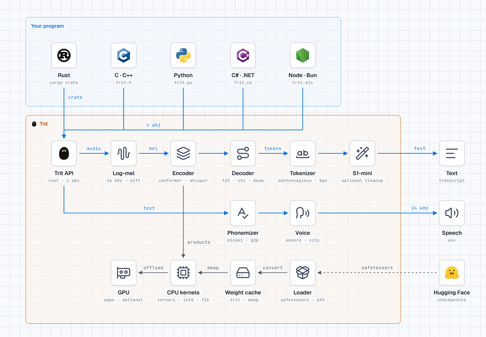

# Trit

Trit is a speech-to-text and text-to-speech engine for the CPU, written in
Rust. It runs Parakeet, Canary, Whisper, Moonshine, Qwen3-ASR, and wav2vec 2.0
checkpoints as published on Hugging Face, NeMo files, and every speech model of
the transcribe.cpp GGUF catalog (Granite Speech, Voxtral, Fun-ASR, SenseVoice,
GigaAM, Cohere Transcribe, and more), with its own kernels: no Python, no
PyTorch, no ONNX Runtime.
It can also clean a transcript with Superwhisper S1-mini, and speak text with
Kokoro-82M (28 English voices) or a VITS voice.
It runs on Windows, Linux, macOS, and Android, on x86-64 and arm64, with
kernels for AVX-512, AVX2, and Arm NEON (`sdot` and `smmla` on Apple M chips).

[TDT](https://github.com/Hi9841/tdt), an offline dictation app for Windows,
uses Trit for all of its speech. Trit is free under the AGPL-3.0; commercial
use needs a commercial licence (see [License](#license)).

**[Reference](docs/reference.md)** ·
**[Website and benchmarks](https://hi9841.github.io/trit/)** ·
**Agents:** read [AGENTS.md](AGENTS.md) first.

<p align="center">
  
</p>

## Quick start

```powershell
git clone https://github.com/Hi9841/trit
cd trit
cargo build --release                       # the CLI and the Rust library
hf download moondream/parakeet-redux config.json tokenizer.json model.safetensors --local-dir models/parakeet-redux
./target/release/trit transcribe take.wav
```

```text
model: ~/tdt/trit/models/parakeet-redux
files: 1 transcribed, 0 failed, 6.0 s of audio in 0.04 s (172x realtime)
results[1]{file,seconds,ms,text}:
  take.wav,6.0,35,"Restart the Kubernetes pod, then check the PostgreSQL logs."
```

`cargo install --git https://github.com/Hi9841/trit` puts only the `trit`
command on your PATH. `trit doctor` tells you what is missing and how to fix
it.

## Use it from your program

| Language | How | Reference |
|---|---|---|
| Shell, scripts | `trit transcribe`, `trit clean`, `trit speak` | [Command line](docs/reference.md#command-line) |
| Rust | `trit = { git = "https://github.com/Hi9841/trit" }` | [Rust](docs/reference.md#rust) |
| C, C++, Go, Swift, Zig | `cargo build --release -p trit-ffi` and [include/trit.h](include/trit.h) | [C ABI](docs/reference.md#c-abi) |
| Python | [bindings/python/trit.py](bindings/python/trit.py), one file, no dependencies | [Python](docs/reference.md#python) |
| C# and .NET | [bindings/csharp/Trit.cs](bindings/csharp/Trit.cs) | [C# and .NET](docs/reference.md#c-and-net) |
| Node and Bun | [bindings/node/trit.mjs](bindings/node/trit.mjs) with koffi | [Node and Bun](docs/reference.md#node-and-bun) |

Every integration follows [the contract](docs/reference.md#the-contract):
mono `f32` audio (at 16 kHz, or with its sample rate), load the engine once,
and share it between threads.

## Select a model

Measured on 456 English clips, AMD Ryzen 9 7950X3D, Trit's default settings.
The other models, the GPU, text to speech, and the full results are in the
[reference](docs/reference.md#models) and in
[docs/engine-comparison.md](docs/engine-comparison.md).

| Model | Size | Word error rate | Time per clip | Use it for |
|---|---:|---:|---:|---|
| `parakeet-redux` | 178 MB | 3.37 % | 36 ms | The default: small, fast, accurate. TDT uses it. |
| `parakeet-unified-en-0.6b-q8_0` | 731 MB | **2.05 %** | 50 ms | The fewest errors, in English. A Q8_0 GGUF file. |
| `parakeet-tdt-0.6b-v3` | 2.5 GB | 2.38 % | 39 ms | The fewest errors in 25 European languages. |
| `moonshine-tiny` | 108 MB | 6.41 % | 37 ms | The smallest English model. |
| `whisper-tiny` | 151 MB | 8.75 % | 67 ms | 99 languages in a small model. |

## License

Trit is under the [GNU AGPL-3.0](LICENSE): free for personal, academic,
and research use. To use it in a commercial product or a paid service, get
a commercial licence ([LICENSING.md](LICENSING.md),
[COMMERCIAL.md](COMMERCIAL.md)).

Each model has its own license: Parakeet and Canary CC-BY-4.0 (Parakeet
Unified English: the NVIDIA Open Model License), Whisper and
Moonshine MIT, S1-mini Apache-2.0 with a naming clause, MMS-TTS
CC-BY-NC-4.0 (noncommercial), Kokoro-82M and the G2P fallback Apache-2.0.
The models of the transcribe.cpp catalog keep their upstream licenses, and
some are noncommercial: see [Models](docs/reference.md#models) and the
[License](docs/reference.md#license) section of the reference.
Follow it when you ship the model. The phonemizer's lexicons (misaki, Apache-2.0) and
tagger (MIT) ship in Trit: see [THIRD_PARTY_NOTICES.md](THIRD_PARTY_NOTICES.md).
